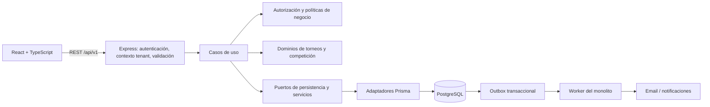

# SETPOINT — Arquitectura backend y modelo de datos

**Estado:** propuesta técnica alineada con [la especificación funcional](functional-specification.md). El repositorio todavía no tiene backend, esquema Prisma ni migraciones. Este documento describe límites, relaciones y secuencia de implementación; no constituye una decisión reglamentaria abierta ni una implementación.

## 1. Decisiones técnicas

- Monolito modular con Node.js, Express, TypeScript, PostgreSQL y Prisma.
- API REST versionada en `/api/v1`.
- Una base PostgreSQL compartida para la primera versión; cada recurso operativo pertenece a una organización y lleva su `organization_id`.
- Capas separadas: HTTP → aplicación/casos de uso → dominio → adaptadores de infraestructura. Express y Prisma no entran en el motor deportivo.
- El formato de competición, las reglas deportivas y el validador/representación de score son contratos separados y versionados.
- El motor del MVP implementa únicamente zonas + eliminación directa, con algoritmo puro y pruebas independientes de HTTP y persistencia. Otros formatos se agregan por etapas.
- Auditoría append-only, versiones de resultados, ledger de puntos append-only e idempotente.
- Outbox transaccional y worker del mismo despliegue para tareas posteriores (correo y otras integraciones). Un evento pendiente en outbox no equivale a una notificación entregada.
- No iniciar con microservicios ni crear todas las entidades de fases futuras en la primera migración.



### Estructura objetivo

Es una estructura futura; no se mueve ni se rehace el frontend actual en esta etapa documental.

```text
apps/
  web/                            # frontend React existente
  api/src/
    app.ts                        # composición de Express y middleware
    modules/<modulo>/
      domain/                     # entidades, reglas e invariantes
      application/                # casos de uso y puertos
      infrastructure/             # repositorios Prisma y adaptadores
      http/                       # rutas, validación, DTOs
    shared/                       # contexto, errores, logging, autorización común
  worker/src/                     # consumo de outbox, mismo monolito
packages/
  competition-engine/             # dominio puro, sin Express ni Prisma
  contracts/                      # contratos compartidos si aportan valor
prisma/
  schema.prisma
  migrations/
```

Los modelos Prisma no se exponen como contratos HTTP. Las rutas convierten DTOs explícitos a casos de uso y devuelven DTOs distintos para vistas públicas, jugador y administración.

## 2. Módulos y propiedad

| Módulo | Responsabilidad | Fase |
|---|---|---|
| Identidad | Cuentas, sesiones, verificación, recuperación y consentimiento de vinculación del perfil. | MVP |
| Organizaciones y permisos | Workspaces, membresías, roles, permisos, invitaciones y aislamiento tenant. | MVP |
| Jugadores | Perfil deportivo, registro local por organización, asignación individual y vínculo de cuenta consentido. | MVP |
| Instalaciones | Club/complex local, sede y canchas; disponibilidad operativa. | MVP, mínimo necesario para programar |
| Torneos y categorías | Torneos independientes, estados, visibilidad y configuración libre por categoría. | MVP |
| Inscripciones | Solicitudes pendientes, decisiones individuales, registro manual, cupos y entrada efectiva. Sin listas ni estados de espera. | MVP |
| Motor de competición | Draw, zonas, standings, clasificación y eliminación directa. | MVP: zonas + eliminación directa |
| Reglas deportivas y score | Versiones explícitas de reglas por categoría/partido y validación de marcadores. | MVP |
| Resultados e incidencias | Revisiones de resultado, WO, recalculación y auditoría. | MVP |
| Programación | Disponibilidad, planes, propuesta, revisión, aprobación y versiones publicadas. | MVP |
| Rankings | Categoría individual, esquemas versionados, vigencia móvil de 52 semanas y ledger. | MVP |
| Perfil, estadísticas y logros | Proyecciones desde resultados reales y visibilidad controlada. | MVP esencial; galería avanzada posterior |
| Notificaciones | Preferencias, outbox, entrega interna/email y deduplicación. | Base MVP; automatizaciones posteriores |
| Finanzas | Cargos, pagos, webhooks, comprobantes y conciliación. | Futuro; no bloquea torneos |
| Circuitos compartidos | Asociaciones N:M entre circuitos, organizaciones y clubes. | Futuro; sin tablas/dependencias en MVP |

Los módulos acceden a otros a través de casos de uso/puertos o eventos de dominio. Evitar que todos dependan de un cliente Prisma global sin límites.

## 3. Tenancy, privacidad y permisos

### Aislamiento por organización

Usar una base y esquema compartidos con `organization_id NOT NULL` en toda fila operativa de organización: jugadores locales, instalaciones, torneos, categorías, inscripciones, draw, partidos, resultados, programación, ranking, notificaciones operativas y auditoría.

- El `organization_id` se obtiene del contexto autenticado y de una membresía vigente; nunca se acepta como autoridad desde el body.
- Cada consulta/mutación tenant-scoped incluye `organization_id` y el ID del recurso.
- Usar unicidades y FKs compuestas `(organization_id, id)` para impedir relaciones accidentales entre tenants.
- El usuario/cuenta de login es global. El perfil deportivo puede vincularse a registros locales solo tras verificación y consentimiento por campos.
- No compartir datos privados ni ranking de una organización con otra. La cuenta puede consultar los registros que reclamó y enlazó; las agregaciones personales nunca abren acceso administrativo al tenant.

Las políticas de acceso de aplicación son obligatorias. Row-Level Security de PostgreSQL puede considerarse como defensa adicional, con contexto por transacción y rol sin privilegios de bypass; no reemplaza las comprobaciones de tenant ni las FKs. La integridad referencial de PostgreSQL no se filtra por RLS ([Prisma: claves compuestas](https://docs.prisma.io/docs/orm/prisma-client/special-fields-and-types/working-with-composite-ids-and-constraints), [PostgreSQL: Row Security](https://www.postgresql.org/docs/current/ddl-rowsecurity.html)).

### Autorización

- `User` tiene cuentas y sesiones; `OrganizationMembership` conecta la cuenta con una organización y un estado.
- Roles globales de plataforma, si se necesitan, quedan separados de los roles del tenant.
- Roles iniciales por organización: `owner`, `organization_admin`, `tournament_manager`, `scorekeeper` y `viewer`.
- Roles y permisos se asignan a membresías. Un participante de torneo no recibe membresía ni rol administrativo por inscribirse.
- Cada caso de uso exige permiso, tenant coincidente, recurso accesible y transición de estado válida. Por ejemplo, `match.result.write` comprueba permiso de escritura de resultado y que la competición admita la acción.
- Se separan permisos de gestión de usuarios, configuración, publicación, programación y resultados cuando corresponda.
- La ruta pública entrega únicamente datos publicados según la visibilidad. Los enlaces a torneos privados permiten consultar información autorizada, pero no inscribir ni autenticar. Enviar una solicitud exige una cuenta `User` y sesión autenticada; los enlaces nunca otorgan permisos operativos ni administrativos.
- Cada acción administrativa se audita en backend. Ocultar controles en React es únicamente UX.

## 4. Modelo de datos propuesto

UUID como identificador; timestamps UTC. Campos JSON se reservan para configuraciones/scores versionados y validados. Las relaciones consultables y restricciones permanecen normalizadas.

### Entidades y relaciones

| Área | Entidades principales | Ámbito |
|---|---|---|
| Cuenta y acceso | `User`, `AuthSession`, `Organization`, `OrganizationMembership`, `Role`, `Permission`, `MembershipRole`, `RolePermission`, `OrganizationInvitation` | User global; permisos y membresías tenant-scoped |
| Perfil y categoría individual | `PlayerProfile`, `OrganizationPlayer`, `PlayerOrganizationLink`, `PlayerPrivateData`, `IndividualCategory`, `PlayerCategoryAssignment` | Perfil de cuenta global con link consentido; registros y categorías locales |
| Club/instalación | `Club`, `SportsComplex`, `Venue`, `Court`, `CourtAvailability`, `PlayerClubMembership` | Tenant-scoped en MVP; participación del jugador opcional |
| Torneos | `Tournament`, `TournamentShareLink`, `TournamentCategory`, `SportRuleSetVersion`, `ScoreRuleVersion`, `CompetitionFormatVersion` | Tenant-scoped; no requiere temporada ni circuito |
| Inscripción | `Registration`, `RegistrationMember`, `CompetitionEntry`, `EntryRosterRevision`, `EntryRosterMember` | Tenant-scoped; no existe tabla de espera |
| Draw y formato inicial | `DrawRevision`, `DrawAssignment`, `CompetitionStage`, `CompetitionGroup`, `CompetitionRound`, `Match`, `MatchSide`, `AdvancementRule`, `StandingProjection` | Tenant-scoped |
| Resultado | `MatchResultRevision`, `MatchIncident` | Tenant-scoped, histórico |
| Programación | `SchedulePlan`, `SchedulePlanRevision`, `CourtBooking`, `PlayerAvailability` | Tenant-scoped |
| Ranking | `RankingDefinition`, `PointScheme`, `PointSchemeVersion`, `PositionPointValue`, `PlayerPointsLedgerEntry` | Tenant-scoped, ranking individual |
| Perfil y logros | `PlayerStatsProjection`, `AchievementDefinition`, `PlayerAchievementAward` | Derivados de resultados; visibilidad explícita |
| Transversal | `AuditEvent`, `OutboxEvent`, `NotificationPreference`, `Notification`, `NotificationDelivery` | Auditoría/outbox tenant-aware; entrega por usuario/canal |

### Identidad y jugadores

1. `User`: email de autenticación normalizado/único, hash de contraseña si la autenticación es local, estado y verificación. Es la fuente de verdad exclusiva para acceso y comunicaciones de cuenta.
2. `PlayerProfile`: perfil deportivo controlado por la cuenta: nombre, apellido, email/teléfono de contacto deportivo, fecha de nacimiento, ciudad, género opcional, foto y preferencias de visibilidad. Su email de contacto es independiente, opcional y no autentica ni se sincroniza automáticamente con `User.email`; `User.email` sigue siendo la fuente de verdad para la cuenta.
3. `OrganizationPlayer`: registro local creado por el organizador, incluso sin cuenta; contiene el nombre visible local, referencia propia y estado.
4. `PlayerOrganizationLink`: asociación verificada entre cuenta/perfil y registro local, alcance/campos consentidos, fecha de concesión y revocación. Revocar acceso no borra resultados históricos.
5. `PlayerPrivateData`: datos privados que administra una organización; la lectura requiere permiso y contexto tenant.
6. `IndividualCategory`: categoría de ranking que la organización define con nombre libre.
7. `PlayerCategoryAssignment`: asignación explícita del registro local a su categoría individual. Se exige asignación antes de aceptar su participación. Guardar vigencia/historia para no inferir ni reescribir destinos antiguos; política exacta de cambios está abierta.

Cada consulta de perfil privado entra por `OrganizationPlayer` y autorización local. No fusionar automáticamente duplicados por email/teléfono. La relación de club del jugador es opcional; ausencia significa independiente.

### Instalaciones y torneo

- `Club` representa una entidad deportiva local, `SportsComplex` un conjunto de instalaciones, `Venue` la sede física y `Court` una cancha concreta. Pueden tener relación opcional entre sí; no son sinónimos.
- Una organización puede registrar sedes/canchas para operar. Un torneo independiente no requiere club. En MVP son registros locales; la identidad de clubes compartidos entre organizaciones pertenece a la futura capa circuito.
- `Tournament` pertenece a una organización y contiene visibilidad `PUBLIC/PRIVATE`, estado, nombre, fechas, zona horaria y sede opcional. No hay entidad obligatoria de temporada ni serie.
- `TournamentShareLink` permite consultar información autorizada de un torneo privado. Guardar hash de un token seguro y no predecible, alcance limitado a la consulta de ese torneo, creador, expiración y revocación. El token no autentica al jugador ni habilita solicitudes: enviar una solicitud requiere una cuenta `User` registrada y sesión autenticada por el flujo normal. El enlace nunca permite aceptar solicitudes, modificar participantes, gestionar el torneo ni ejecutar acciones administrativas, y jamás concede roles.
- Estados: `DRAFT`, `PUBLISHED`, `REGISTRATION_CLOSED`, `PREPARING`, `IN_PROGRESS`, `SUSPENDED`, `FINISHED`, `CANCELLED`; transiciones servidor-side descritas en la especificación funcional. Guardar estado previo al suspender y actor/motivo de transición.
- `TournamentCategory` tiene nombre libre, deporte, modalidad, género/nivel opcionales, cupo, formato, reglas de score, desempates, política/destino de ranking y disponibilidad. No referencia un catálogo cerrado ni deriva reglas del nombre. El cupo es el máximo de entradas ocupadas o reservadas: jugadores individuales en singles y parejas (una entrada por pareja) en dobles/pádel; 32 equivale a 32 jugadores en singles o 32 parejas (64 jugadores) en dobles/pádel.
- El destino de ranking se configura explícitamente. Categorías regulares apuntan a una `IndividualCategory` elegida; una categoría `Mixto` no tiene ranking propio y usa la categoría individual de cada integrante. La correspondencia para formatos/categorías regulares cuyos participantes tengan destinos distintos queda abierta; no derivarla del nombre.
- `ScoreRuleVersion` es inmutable y separada de `CompetitionFormatVersion`. Un partido/categoría fija las versiones empleadas.

### Inscripciones, roster y cupos

`Registration` diferencia `PLAYER_REQUEST` de `ORGANIZER_MANUAL`, con estados `PENDING`, `CONFIRMED`, `REJECTED`, `WITHDRAWN`/`REMOVED` según ciclo. Toda inscripción de jugador se crea con una cuenta `User` registrada y sesión autenticada; el backend vincula la inscripción con la cuenta y el `PlayerProfile` del solicitante. En singles se completa el registro del jugador; en dobles/pádel se completa el registro de ambos integrantes de la pareja. Mientras el formulario está incompleto no existe reserva ni consumo de cupo. Al enviar una inscripción completa se crea en estado `PENDING` y reserva una plaza inmediatamente. Crear una cuenta no crea inscripción. No existe flujo anónimo ni inscripción de jugador sin cuenta. Una incorporación manual autorizada por el organizador también debe estar vinculada a cuentas; `OrganizationPlayer` sin cuenta puede existir como registro local, pero no puede ser inscripción ni `CompetitionEntry`. `RegistrationMember` registra a los integrantes de cada entrada.

Pádel valida dos integrantes; tenis, uno o dos según modalidad configurada. `CompetitionEntry` representa la entrada incorporada a la competición y se crea al aceptar la inscripción, conservando la misma plaza que ya estaba reservada mientras la solicitud estaba `PENDING`; la aceptación no reserva una plaza adicional. El organizador puede aceptar o rechazar cada inscripción completa pendiente. Rechazarla o registrar un retiro válido libera la plaza; la aceptación mantiene la ocupación. La incorporación manual autorizada crea una inscripción completa y su entrada dentro de una sola operación.

**No crear `Waitlist`, cola ni estado de espera. No crear reemplazo automático.** Las revisiones de roster conservan la composición original y los cambios manuales autorizados antes del inicio, sujetos a validación de elegibilidad y composición de la categoría, con actor, fecha y motivo auditados; la ventana exacta para esos cambios permanece abierta. Una vez iniciada la competición, el abandono se resuelve mediante WO en el partido afectado, sin incorporar automáticamente otro participante ni alterar la composición de partidos históricos.

Cada inscripción completa `PENDING` o `CONFIRMED` ocupa exactamente una plaza; solicitudes incompletas, rechazadas o retiradas no ocupan. Al alcanzar el cupo se cierran nuevas inscripciones. Una plaza liberada por rechazo o retiro válido vuelve a estar disponible; una categoría cerrada manualmente solo se habilita mediante reapertura autorizada. Nunca usar una lista de espera para resolver una sobreventa.

### Motor de competición y draw

`competition-engine` es TypeScript puro. Entrada: participantes confirmados, formato/config versionada, categorías individuales/rankings disponibles y reglas relevantes. Salida: propuesta de `DrawRevision`, asignaciones a grupos/seed, cruces y proyecciones. No consulta HTTP, Prisma ni reloj global; dependencias necesarias llegan como argumentos.

**Único formato MVP:** zonas (`CompetitionGroup`) + fase de eliminación directa. Configura cantidad/tamaño de zonas, clasificación por zona, criterios de desempate ordenados y armado automático/manual de cruces. Cada configuración se valida antes de generar el draw. Se persiste preview sin publicarlo; aprobación del organizador publica la revisión.

`DrawRevision` guarda versión de algoritmo/config, instante y origen de siembra, snapshot de ranking usado o semilla aleatoria reproducible, y referencia a la revisión anterior. `DrawAssignment` guarda participante, zona, seed/posición y motivo/actor en cambios manuales. El original nunca se sustituye: se puede auditar propuesta inicial y correcciones.

Si hay ranking individual vigente con puntos, se usa para cabezas de serie/bombos equilibrados. Si no hay puntos, se usa sorteo aleatorio. La edición manual se permite antes de confirmar. Cómo combinar rankings para dobles/mixto sigue abierto y no se hardcodea como suma o promedio.

Cada formato futuro tendrá su propia estrategia/validación/pruebas y podrá agregar etapas; no se implementan otros formatos en MVP. No existe un `FormatDefinition` que anuncie como disponibles Americano, Mexicano, Pozo, liga, round robin aislado o doble eliminación en esta fase.

### Partidos, resultados y WO

- `CompetitionStage`/`Round` secuencian zonas y cuadro; `CompetitionGroup` representa zona.
- `Match` y dos `MatchSide` conectan entradas/slots y la revisión del roster aplicable. `AdvancementRule` conecta resultado/posición de origen con siguiente cruce.
- `MatchResultRevision` append-only guarda número, score payload, regla/version, ganador, tipo normal/WO, actor, hora, motivo, publicación y referencia de revisión previa.
- Score JSON no es arbitrario: se valida por `ScoreRuleVersion`, normaliza ganador y parciales, y no se guarda si es inválido.
- WO se conserva con su identificador, pero cuenta como W/L normal para clasificación y puntuación; no genera puntos especiales ni sustituciones.
- Una corrección crea otra revisión y en una transacción recalcula standings, avance, puntos, estadísticas y logros afectados. Las proyecciones son reconstruibles desde revisiones.
- Corregir un resultado publicado requiere permiso, motivo y confirmación del impacto; no se elimina evidencia.

### Categorías y rankings individuales

`IndividualCategory` pertenece a la organización y no equivale a `TournamentCategory`. Las categorías de torneo son de nombre libre; las categorías individuales destino de ranking son asignaciones explícitas.

`TournamentCategory` guarda `ranking_destination_mode` y, para el modo directo, un `individual_category_id`. Las categorías de singles y dobles que representan la misma categoría individual apuntan a la misma `IndividualCategory`; no se deriva la relación de las etiquetas. En `Mixto`, el modo es `PER_MEMBER_CATEGORY` y no existe categoría destino propia: cada integrante resuelve sus puntos desde la asignación individual vigente.

- Singles y dobles de una misma categoría individual apuntan a la misma `RankingDefinition` (organización + categoría individual), nunca a rankings separados por modalidad.
- La categoría de competición fija su política de destino. En modalidad regular se asigna explícitamente su categoría individual de ranking; no se infiere por nombre.
- Una categoría de competición Mixto no tiene `RankingDefinition` propio. Para cada participante, se resuelve el destino desde su `PlayerCategoryAssignment`; cada uno recibe su movimiento individual en la categoría propia. La asignación es requisito para aceptar la participación; no se crea entrada ni se emiten puntos sin ella.
- `PointScheme`/`PointSchemeVersion` guarda una tabla versionada posición → puntos, creada/reutilizable por el organizador. `PositionPointValue` contiene la cantidad para cada puesto; la versión queda ligada a la acreditación.
- El formato determina posiciones y el esquema aplica puntos. Si no puede determinar puesto único, el caso requiere regla/decisión y no se inventan puntos.

`PlayerPointsLedgerEntry` incluye organización, jugador local, categoría individual destino, torneo/categoría de competición, resultado/revisión, posición, delta, versión de esquema, `awarded_at`, `expires_at`, origen/idempotency key, motivo y referencia a movimiento revertido si aplica. Inmutable: correcciones agregan reversas/ajustes compensatorios, nunca actualizan/borran la fila fuente.

Los puntos son vigentes durante ventana móvil de 52 semanas desde la fecha de acreditación. El ranking suma entradas vigentes, sin reinicio anual ni límite de mejores resultados. Lo vencido permanece en el ledger y deja de sumar. Definir precisión de fechas y valoración temporal de correcciones como decisión abierta antes de codificar.

### Estadísticas y logros

`PlayerStatsProjection` deriva partidos, victorias/derrotas, win rate, títulos, podios y evolución del historial deportivo. Se puede reconstruir tras corregir resultado. `AchievementDefinition` versiona hitos; `PlayerAchievementAward` conserva cuándo/fuente se otorgó y, si una corrección invalida un logro, un estado de revocación auditable. El vencimiento del ranking no revoca un logro histórico.

Foto/galería se almacenan fuera de filas de resultado; el perfil solo mantiene referencia y visibilidad. Las políticas finales de datos públicos/privados y galería están abiertas.

### Programación y calendarios

- `CourtAvailability` y `PlayerAvailability` son disponibilidades, no reservas confirmadas.
- `SchedulePlan` distingue borrador; `SchedulePlanRevision` registra propuesta automática o edición manual. Una versión aprobada/publicada se identifica explícitamente.
- `CourtBooking` guarda cancha, partido, intervalo, zona horaria de presentación, estado y revisión del plan. Cambios a calendario publicado crean nueva revisión.
- El planificador valida solapamiento de cancha, jugador/miembro de pareja en categorías cruzadas, duración y descanso mínimo. La propuesta no publica ni modifica fixtures sin aprobación.
- La reserva sin conflicto debe protegerse ante concurrencia con transacción y constraint/index PostgreSQL apropiado para intervalos (posible exclusion constraint); se agrega mediante migración SQL si Prisma no lo expresa. La validación también incluye jugadores simultáneos a nivel de aplicación.

### Clubes, notificaciones y módulos posteriores

El MVP guarda clubes/complejos dentro del tenant que los administra y permite una afiliación voluntaria del jugador. Circuitos futuros usarían asociaciones N:M entre `Circuit`, `Organization`, clubes locales y torneos; no se crean estas entidades ahora, y un circuito no se supone propiedad de una sola organización.

Notificación usa `NotificationPreference`, `OutboxEvent`, `Notification` y `NotificationDelivery` con idempotency key. Outbox se escribe en la misma transacción del cambio de dominio; worker marca intentos/resultado. Interno/email primero; WhatsApp posterior. No indicar “entregada” hasta confirmación del canal.

Finanzas queda como módulo de extensión. Cuando se agregue, separar `Charge`, `Payment`, `PaymentAttempt`, webhook y devolución; checkout redirect no es prueba de pago.

## 5. Transacciones, auditoría e integridad

Hacer atómicos, como mínimo:

- enviar inscripción completa y reservar plaza; aceptar sin doble conteo; rechazar/retirar y liberar plaza;
- crear draw y su primera asignación;
- guardar revisión de resultado, recalcular proyección de standings/avance y crear ledger idempotente;
- añadir reversas/ajustes de puntos y proyecciones tras corrección;
- crear revisión de programación y sus bookings;
- persistir cambio y su `OutboxEvent`.

Mantener transacciones cortas y sin llamadas de red. La creación de solicitudes y todo cambio de estado que afecte al cupo deben serializarse por categoría (por ejemplo, bloqueando la fila de `TournamentCategory`), recalcular plazas ocupadas/reservadas y validar el límite antes de confirmar. La creación completa y reserva se persisten juntas; aceptación y creación de `CompetitionEntry` se confirman juntas sin incrementar la ocupación; rechazo/retiro y liberación también se confirman juntos. Rechazar la transacción cuando no quede plaza y admitir reintentos acotados ante conflictos. Prisma admite transacciones secuenciales e interactivas ([Prisma: transacciones](https://docs.prisma.io/docs/orm/prisma-client/queries/transactions)).

`AuditEvent` append-only almacena tenant, actor, permiso/acción, recurso, motivo, timestamp, request/correlation ID y before/after minimizado/redactado. No guardar contraseñas, credenciales, datos de pago ni PII que no haga falta.

Integridad mínima:

- FKs y unicidades compuestas impiden cruzar tenants.
- Email normalizado y slug único; nombres de categoría libres y sin catálogo cerrado.
- La cantidad de inscripciones completas pendientes y aceptadas nunca excede el cupo, incluso bajo concurrencia; rechazo/retiro libera una plaza de forma atómica.
- Integrantes cumplen modalidad configurada; toda persona de competición tiene categoría individual asignada.
- Resultado pasa la regla versionada; WO se identifica.
- Draw/score/ranking/schedule config se versionan y no reescriben historia.
- Restricciones/locks de programación previenen reservas de cancha y jugador simultáneas.
- Puntos vencidos no se borran; el cálculo de ranking excluye fuera de ventana.
- Webhooks/outbox/ledger protegen duplicados con claves de idempotencia.

## 6. API y experiencia

Rutas REST iniciales sugeridas, sujetas a contratos DTO:

```text
/api/v1/auth/*
/api/v1/me
/api/v1/organizations
/api/v1/organizations/:organizationId/members
/api/v1/organizations/:organizationId/players
/api/v1/organizations/:organizationId/individual-categories
/api/v1/organizations/:organizationId/tournaments
/api/v1/organizations/:organizationId/tournaments/:tournamentId/categories
/api/v1/organizations/:organizationId/tournaments/:tournamentId/share-links
/api/v1/organizations/:organizationId/categories/:categoryId/registrations
/api/v1/organizations/:organizationId/categories/:categoryId/draw-revisions
/api/v1/organizations/:organizationId/matches/:matchId/result-revisions
/api/v1/organizations/:organizationId/schedule-plans
/api/v1/organizations/:organizationId/rankings/:individualCategoryId
/api/v1/me/player-profile
/api/v1/me/participations
/api/v1/me/registrations
/api/v1/public/tournaments/:slug
/api/v1/shared/tournaments/:token
```

`POST /api/v1/me/registrations` crea una solicitud de inscripción y requiere una cuenta de jugador autenticada; el backend deriva de la sesión la identidad del solicitante y valida la categoría y el torneo. `GET /api/v1/shared/tournaments/:token` permite únicamente consultar la información autorizada del torneo privado. El token compartido no crea solicitudes ni autentica al jugador.

Orden middleware: request/correlation ID y límites → autenticación para rutas de jugador → contexto de tenant/membresía o validación del alcance de lectura del token compartido → validación de entrada → policy/recurso → caso de uso → DTO. Errores de dominio se traducen a contrato HTTP estable; no devolver SQL ni stack traces. Mutaciones concurrentes usan versión/ETag y `409`; operaciones repetibles aceptan idempotency key. El token compartido no sustituye permisos para aceptar solicitudes, modificar participantes o administrar el torneo.

## 7. Secuencia de implementación prevista

1. Fundación: Express/TypeScript, PostgreSQL/Prisma, migraciones iniciales, config segura, logs/errores.
2. Cuentas, workspaces, membresías, roles y autorización multi-tenant.
3. Perfiles, registros locales, consentimientos, categorías individuales y asociaciones opcionales de club.
4. Torneo, categoría libre, reglas configurables, inscripciones individuales y control atómico de cupos (sin lista de espera).
5. Motor zonas + eliminación directa: draw versionado, siembra ranking/sorteo, edición manual, desempates, cruces, BYE y standings. Cubrir con pruebas de reglas, distribución y clasificación.
6. Score/WO versionados, resultados, correcciones, auditoría, ranking 52 semanas, estadísticas y logros.
7. Programación, aprobación, calendario versionado y notificaciones internas/email.
8. Etapas posteriores separadas: pagos, nuevos formatos, WhatsApp y circuitos multi-organización.

Las decisiones abiertas no bloquean la fundación técnica ni los módulos independientes de ellas. Implementar cada funcionalidad solo cuando sus reglas de negocio relevantes estén resueltas. Por ejemplo, autenticación, organizaciones, permisos y estructura básica de torneos pueden desarrollarse antes de definir desempates o reglamentos deportivos; el motor de competición y los validadores deportivos esperan esas decisiones. No generar todas las tablas de una vez: cada migración se justifica por un flujo vertical implementado.

## Requisitos operativos de seguridad para etapas posteriores

- **HTTPS en producción:** obligatorio para proteger las credenciales y los tokens Bearer durante el transporte. La API no termina TLS por sí sola; el punto de entrada público (proxy, gateway o plataforma de despliegue) debe imponer HTTPS.
- **Rate limiting distribuido:** la implementación inicial usa almacenamiento local en memoria. Al desplegar varias instancias, sustituirlo por un almacén compartido y configurar explícitamente los proxies confiables para identificar clientes correctamente.
- **Autorización tenant-scoped:** antes de añadir endpoints que lean o modifiquen recursos de una organización, validar en cada operación la membresía activa, el permiso/rol requerido y que el recurso pertenezca a esa organización. La autenticación por sí sola no concede acceso a datos del tenant.
- **Limpieza de sesiones:** definir retención y ejecutar una política programada para purgar sesiones vencidas o revocadas sin interferir con auditoría o soporte.

## 8. Decisiones confirmadas y abiertas

### Confirmadas

- El tenant operativo es la organización; los torneos independientes funcionan solos.
- Categorías con nombres libres, configuración individual y deporte/modalidad explícitos.
- Roles iniciales y participante sin privilegios de organización.
- Registros locales de jugador pueden existir sin cuenta; vinculación con cuenta requiere verificación/consentimiento.
- Categoría individual asignada es obligatoria para participar y para destino de puntos.
- Pádel dobles; tenis singles/dobles; composición de parejas se conserva por revisión.
- Todo jugador requiere cuenta SETPOINT; las solicitudes web requieren sesión autenticada, quedan pendientes de decisión individual del organizador y se vinculan con cuenta/perfil. La inscripción completa pendiente reserva cupo; rechazo/retiro lo libera. Crear cuenta no inscribe; no hay flujo anónimo ni inscripción sin cuenta. La incorporación manual autorizada también queda vinculada a una cuenta; sin waitlist.
- Sin reemplazo automático durante competición; abandono en torneo iniciado se registra como WO.
- Único formato MVP: zonas + eliminación directa; ranking vigente para seed, aleatorio si no hay puntos y edición manual antes de aprobar.
- Puntuación por posiciones configurable/versionada; ranking individual por categoría, ventana móvil 52 semanas.
- Mixto sin ranking propio: cada jugador puntúa en su categoría individual asignada.
- Score/reglamentos versionados; WO es victoria/derrota normal.
- Propuesta de programación editable y aprobada manualmente; publicación versionada.
- Notificaciones internas/email con outbox; WhatsApp y circuitos multi-organización posteriores.

### Abiertas

Tomar la tabla de decisiones de [la especificación funcional](functional-specification.md) como fuente única para reglas de negocio abiertas: combinaciones deportivas, desempates, reglas exactas de score, puntuación/posiciones, siembra de dobles/mixto, cambios de categoría, consentimiento/visibilidad y corrección de resultados publicados. También quedan por definir ventanas de modificación manual de roster antes del inicio, roles custom y precisión temporal de caducidad/reversión de puntos.

No inventar reglamentos, puntos, reglas de draw para parejas ni políticas de visibilidad cuando una decisión abierta afecte al resultado.

## Referencias técnicas oficiales

- Prisma ORM: [claves compuestas](https://docs.prisma.io/docs/orm/prisma-client/special-fields-and-types/working-with-composite-ids-and-constraints), [transacciones](https://docs.prisma.io/docs/orm/prisma-client/queries/transactions).
- PostgreSQL: [Row-Level Security](https://www.postgresql.org/docs/current/ddl-rowsecurity.html), [constraints](https://www.postgresql.org/docs/current/ddl-constraints.html).
- Express: [manejo de errores](https://expressjs.com/en/guide/error-handling/).
